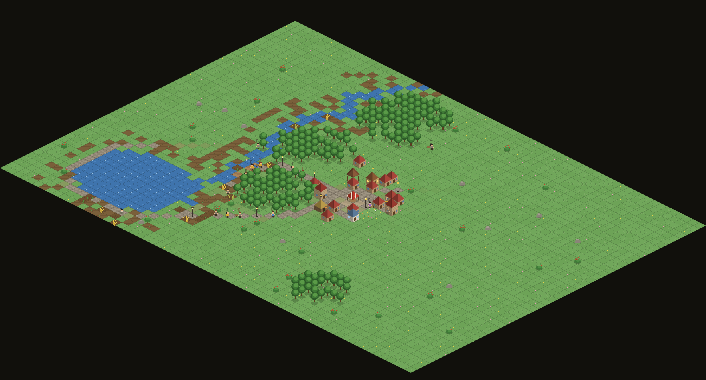
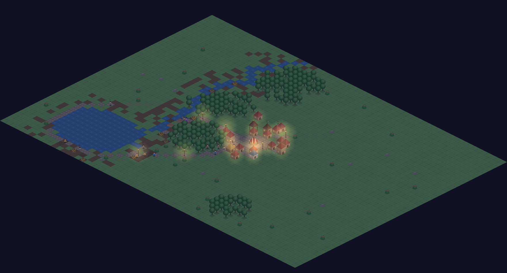

# 🏰 Desa Hidup — Simulasi NPC Emergent

Simulasi dunia desa fantasi berisi NPC yang **belajar, beradaptasi, dan berevolusi secara organik** — tanpa satu pun perilaku yang di-script. Semua drama (cinta, paceklik, trauma, tradisi, dinasti keluarga) muncul sendiri dari interaksi sistem.




## Menjalankan

### Mode lokal (sim jalan di browser)

```bash
npm install
npm run dev
```

Buka `http://localhost:5173`.

### Mode server persisten (desa hidup 24 jam di VPS) 🖥️

Simulasi jalan **headless di Node**; browser cuma jadi *viewer* lewat WebSocket.
Desa terus hidup walau semua tab ditutup, dan **autosave tiap 2 menit** ke
`data/save.json` — restart server, desa bangun lagi dari titik terakhir.

```bash
npm install
npm run build          # bikin dist/ (viewer)
npm run server         # atau: PORT=3000 node server/server.js
```

Buka `http://<ip-server>:3000`. Semua penonton melihat desa yang **sama** —
kontrol kecepatan/jeda berlaku global. Supaya awet, jalankan dengan pm2 /
systemd / `nohup`:

```bash
nohup node server/server.js > desa.log 2>&1 &
```

| ENV | default | fungsi |
|---|---|---|
| `PORT` | `3000` | port HTTP + WebSocket |
| `DATA_DIR` | `./data` | lokasi `save.json` |

## Cara kerja otaknya

### 🧠 Utility AI + Reinforcement Learning
Tiap tick, NPC menilai semua aksi yang mungkin (meramu, memancing, bertani, menebang, berdagang, bersosialisasi, menjelajah, merayu, dsb.) dengan skor:

```
skor = kebutuhan saat ini × sifat kepribadian × nilai-Q (pengalaman) × kondisi dunia
```

Nilai-Q diperbarui dari **hasil nyata** tiap aksi selesai (`q += 0.18 × (reward − q)`). NPC yang sering gagal memancing akan berhenti memancing; yang panennya melimpah makin rajin bertani → **profesi muncul sendiri**, bukan di-assign.

### 🗺️ Peta mental & memori
NPC hanya tahu sumber daya yang **pernah ia temukan sendiri** (lewat menjelajah) atau **dengar dari gosip**. Estimasi hasil tiap lokasi dikoreksi oleh pengalaman — semak yang habis dipetik perlahan "dilupakan", dan NPC mencari alternatif.

### 😱 Trauma lokasi
Diserang serigala meninggalkan memori ketakutan pada koordinat kejadian, yang memengaruhi semua keputusan rute & pemilihan lokasi kerja. Trauma meluruh seiring waktu dan **menular lewat cerita** — satu serangan bisa membuat seisi desa menghindari satu sisi hutan.

### 💬 Gosip = jaringan informasi
Tiap percakapan mempertukarkan: lokasi sumber daya, peringatan bahaya, opini tentang orang ketiga (reputasi menular), dan meme budaya.

### 🎭 Budaya
NPC kreatif sesekali *menciptakan* kebiasaan baru (Tarian Senja, Pai Beri, ...). Kebiasaan menyebar dari mulut ke mulut, diwariskan ke anak, bisa punah, bisa jadi identitas desa.

### 👶 Generasi & seleksi alam
Pasangan terbentuk dari affinity yang tumbuh lewat interaksi. Anak mewarisi sifat orang tua (rajin, supel, berani, penasaran) **plus mutasi acak** — paceklik dan serigala menyeleksi sifat mana yang bertahan lintas generasi.

### 🏛️ Progresi peradaban (emergent, bukan timeline)
Pengetahuan desa (`tani / kayu / konstruksi / dagang`) terakumulasi dari **aktivitas nyata warga** — panen mengajarkan ilmu tani, menebang & membangun mengajarkan pertukangan, transaksi pasar mengajarkan perdagangan. Saat kondisinya matang (ilmu + populasi cukup), warga paling terampil & penasaran bisa **menemukan teknologi** — dengan peluang, bukan jadwal:

| Teknologi | Efek |
|---|---|
| 🛣️ Jalan Batu | jalur setapak teramai dilapisi batu → jalan 50% lebih cepat, A* memprioritaskan jalan |
| 🌉 Jembatan Kayu | sungai bisa diseberangi — wilayah baru terbuka |
| 🛞 Gerobak Dorong | milik pribadi, bisa diwariskan: angkut lebih banyak, ngebut di jalan |
| 🛖 Lumbung Desa | stok pasar nyaris tak membusuk — paceklik jauh lebih aman |
| 🏡 Rumah Papan Besar | rumah 2 lantai, tidur jauh lebih pulih |
| 🏮 Lampu Jalan | malam terang di koridor utama — serigala enggan mendekat |

Urutan penemuan **beda di tiap dunia**, dan pengetahuan **ikut terkubur** bersama ahli yang mati — kehilangan massal bisa memicu kemunduran zaman. Jalan batu dibangun di atas jalur setapak yang benar-benar ramai: **infrastruktur mengikuti perilaku, bukan blueprint**.

### 🍜 Kehidupan kota: usaha & hiburan
Warga punya kebutuhan **Senang** — dan memenuhi kebutuhan itu melahirkan tempat-tempat baru, semuanya dari **inisiatif pribadi NPC** (wirausaha, bukan placement):

- **Warung makan** 🍜 — NPC berbakat dagang memakai modalnya sendiri untuk buka warung di lokasi strategis (dipilih dari data lalu lintas kaki!). Dia menyetok masakan, warga jajan, kas terkumpul. Usaha **diwariskan** ke anak.
- **Kedai teh** 🍵 — tempat nongkrong sore; sarang gosip tempat relasi & budaya menular paling deras.
- **Taman desa** 🌳 dan **Dermaga wisata** 🛥️ — piknik & menikmati pemandangan danau; yang penasaran lebih suka berwisata ke dermaga.
- **Anak-anak bermain** ⚽ — kejar-kejaran di sekitar taman.
- **Festival Panen** 🎪 — saat desa makmur, semua berkumpul di alun-alun yang dihiasi umbul-umbul: menari, berpesta, budaya menyebar dua kali lipat.

### 🏛️ Fasilitas umum & pemerintahan
Saat desa cukup dewasa, warga sendiri yang berinisiatif membangun institusi:

- **Sekolah** 🏫 — tukang berpengalaman membangunnya kalau anak-anak sudah ramai. Anak yang rajin **belajar** naik semua keahliannya *dan* menjaga ilmu desa (penangkal kemunduran zaman saat para ahli wafat).
- **Balai desa** 🏛️ — begitu berdiri, tiap 15 hari warga **musyawarah memilih kepala desa** — yang menang adalah warga paling disegani (rata-rata relasi sosial). Kades ditandai 🎖️ di peta, dan desa yang punya pemimpin menggelar festival lebih sering.
- **Pendopo budaya** 🏯 — kalau satu tradisi dianut ≥60% warga, para penganutnya membangun pendopo untuk **mengabadikan budaya itu**: joglo dua tingkat tempat warga berkunjung, senang, dan tradisi menular.

### 💰 Ekonomi
Harga pasar murni dari supply/demand harian. Panen raya → harga anjlok; musim dingin → pangan meroket. NPC merespons harga (menimbun, beralih profesi, beli vs. cari sendiri).

### 🌍 Dunia dinamis
Siang-malam, 4 musim, sumber daya habis & tumbuh lagi (hutan bisa gundul permanen kalau dieksploitasi), serigala berburu di malam hari, dan gotong royong: teman dekat menolong yang kelaparan — relasi sosial adalah jaring pengaman.

## Struktur kode

| File | Isi |
|---|---|
| `src/npc.js` | Agen: kebutuhan, sifat, keahlian, memori, Q-learning, pathfinding |
| `src/actions.js` | Utility AI — semua aksi & fungsi skornya |
| `src/sim.js` | Orkestrator: siklus hidup, serigala, gotong royong, generasi |
| `src/world.js` | Dunia: terrain prosedural, musim, regrowth, A* |
| `src/social.js` | Gosip, relasi, meme budaya |
| `src/tech.js` | Pohon teknologi emergent & mekanisme penemuan |
| `src/economy.js` | Pasar supply/demand |
| `src/sprites.js` | Tileset pixel-art isometrik digambar prosedural (gaya TheoTown) |
| `src/render.js`, `src/ui.js`, `src/main.js` | Renderer isometrik depth-sorted, inspektor NPC, loop |
| `src/persist.js` | Save/load seluruh keadaan sim ke JSON (termasuk state RNG & relasi antar-NPC) |
| `server/server.js` | Server persisten: sim headless + WebSocket + autosave |
| `src/viewer.js`, `viewer.html` | Klien tipis: terima snapshot WS, render dengan engine yang sama |

### Detail visual
- **Isometrik "3D" ala TheoTown**: proyeksi diamond 2:1, bangunan menjulang dengan dua sisi dinding bershading beda + atap piramida, semua objek diurut berdasarkan kedalaman (painter's algorithm)
- **Jalan setapak organik**: rumput yang sering diinjak NPC perlahan jadi jalan tanah — rute populer desa tergambar sendiri di peta, dan kembali berumput kalau ditinggalkan
- **Siklus cahaya**: fajar/senja oranye, malam biru gelap dengan jendela rumah menyala & cahaya hangat pasar
- **Animasi**: air beriak, langkah kaki NPC, asap cerobong, gandum tumbuh 4 tahap, kepadatan kanopi pohon mengikuti sisa kayunya

Setiap dunia memakai seed acak — tiap kali tombol **🌍 Dunia Baru** ditekan, sejarah yang sama sekali berbeda akan tertulis.
